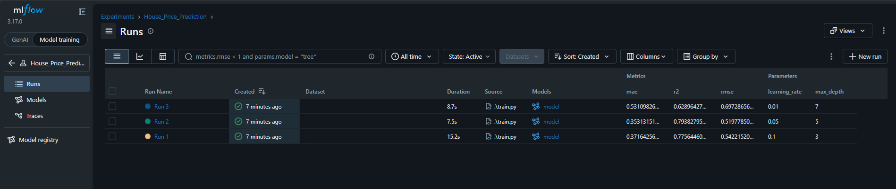

# MLflow Task: House Price Prediction

## 1. Task Description

This project demonstrates how to use MLflow to track and compare machine learning experiments. We train a `GradientBoostingRegressor` on the California Housing dataset using three different hyperparameter configurations (`max_depth` and `learning_rate`). MLflow automatically logs the parameters, evaluation metrics (RMSE, MAE, R²), and the model artifacts for each run to help identify the best-performing model.

## 2. How to Run the Project

1. **Install dependencies:**

   ```bash
   pip install -r requirements.txt
   ```

2. **Run the training script:**

   ```bash
   python train.py
   ```

3. **Launch the MLflow UI:**

   ```bash
   mlflow ui
   ```

4. **View results:** Open your browser and navigate to `http://127.0.0.1:5000` to see the logged experiments.

## 3. MLflow Experiment Results



## 4. Comparison Table

| Run       | Max Depth | Learning Rate | RMSE   | MAE    | R²     |
| --------- | --------- | ------------- | ------ | ------ | ------ |
| **Run 1** | 3         | 0.1           | 0.5422 | 0.3716 | 0.7756 |
| **Run 2** | 5         | 0.05          | 0.5197 | 0.3531 | 0.7938 |
| **Run 3** | 7         | 0.01          | 0.6972 | 0.5310 | 0.6289 |

## 5. Selected Best Model

**Run 2** (`max_depth = 5`, `learning_rate = 0.05`)

## 6. Explanation

Based on the tracked metrics in MLflow, **Run 2** was chosen as the best model because it achieved the lowest **RMSE (0.5197)** on the validation set, which was our primary metric for model selection. It also had the best MAE (0.3531) and the highest R² (0.7938) of the three runs.